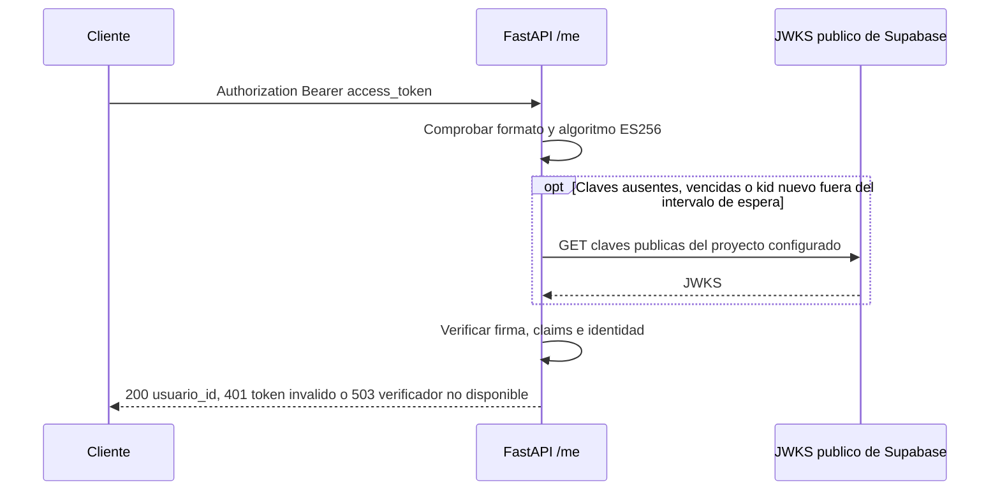

# Primer incremento de autenticacion: FastAPI

## Alcance

GET /me devuelve {"usuario_id": "UUID"} solo despues de verificar un access
token original de Supabase. No consulta PostgreSQL, no crea un perfil o espacio
y no asigna permisos. El BFF y Angular se integran en incrementos siguientes.
US-001 y US-002 no se cierran con este cambio.

ADR-0003 propone ES256. El usuario confirmo ES256 como algoritmo de la clave
activa del proyecto test. Tambien se observo una clave publica EC/P-256/ES256
en su JWKS. Esa observacion por si sola no demuestra que una clave sea activa.
No se modifica el estado del ADR ni se considera probado un token real.

## Configuracion

En gastos-test-api de Render agregar, despues de desplegar este incremento:

    AUTH_SUPABASE_PROJECT_REF=cyxhyfbiacfayixbmotq

Es un identificador publico, no una contraseña. El codigo construye el emisor
https://<ref>.supabase.co/auth/v1 y la URL JWKS a partir de esa configuracion.
El token no puede elegir una URL. No se copia un JWT secret ni una clave privada.

Si falta la configuracion, /me devuelve 503 ante una credencial Bearer y no
admite acceso. Sin credencial responde 401. Las rutas publicas del esqueleto
siguen disponibles. Configuracion invalida requiere corregir la variable y
reiniciar el servicio. El proveedor se mantiene en memoria por proceso.

## Contrato

- Algoritmo fijo ES256, clave publica EC/P-256 y kid obligatorio.
- Firma, emisor exacto y audiencia escalar authenticated verificados.
- exp, iat, sub, role, is_anonymous y session_id obligatorios.
- exp e iat enteros, exp posterior a iat; nbf entero cuando exista.
- Tolerancia temporal de 30 segundos; sub y session_id UUID no nulos.
- role=authenticated e is_anonymous=false estrictos.
- Se rechazan algoritmos alternativos, tokens anon/service_role, headers de
  claves externas, tokens mayores de 16 KiB y Authorization duplicado.
- X-User-Id y otros headers de identidad no autentican al cliente.
- Respuestas privadas y errores con Cache-Control: no-store; 401 incluye
  WWW-Authenticate: Bearer. No se registran tokens ni mensajes del driver HTTP.

La verificacion criptografica usa PyJWT y cryptography. Los tests firman tokens
con claves efimeras generadas en memoria; no usan usuarios ni secretos reales.

## Cache, disponibilidad y rotacion

JWKS: HTTPS, sin redirecciones, timeout HTTP de 5 segundos por operacion, limite
de respuesta de 64 KiB y hasta 16 claves. Cache local durante 300 segundos;
intentos de refresco separados al menos 30 segundos por proceso. El lock evita
descargas simultaneas. Un kid desconocido durante ese intervalo da 401.

Una clave nueva puede requerir hasta 30 segundos para refrescarse; el cache
externo de Supabase agrega su propio plazo. Un fallo al refrescar no admite
tokens sin verificar. Las claves conocidas todavia vigentes pueden seguir
usandose; vencida la cache, el verificador responde 503 si no puede renovarla.

Revocar una clave no borra instantaneamente caches existentes. Para una
emergencia, revocar en Supabase, considerar su cache externa y reiniciar los
servicios para vaciar su cache local. No prometer revocacion inmediata de una
sesion: un token puede seguir siendo valido hasta expirar, como declara ADR-0003.

## Validacion y siguientes pasos

Ejecutar desde apps/api:

    python -m pip install -r requirements.txt
    python -m pip check
    python -m unittest discover -s tests -p 'test_*.py'

La suite cubre tokens firmados, claims, headers, aislamiento de emisor, cache,
rotacion, fallos de JWKS, concurrencia y respuestas HTTP. CI ya ejecuta esa suite.
Abrir /me en el navegador sin token debe devolver 401: es el comportamiento
esperado, no evidencia del camino exitoso de autenticacion.

Pendiente: token real de usuario, verificador equivalente en BFF, reenvio del
token, login Angular, contrato de alta inicial ADR-0004 y contexto RLS por request.
No usar credenciales de app_migrator en requests para resolver el alta.

Referencias:
- https://pyjwt.readthedocs.io/en/stable/api.html
- https://supabase.com/docs/guides/auth/signing-keys
- https://supabase.com/docs/guides/auth/jwt-fields
