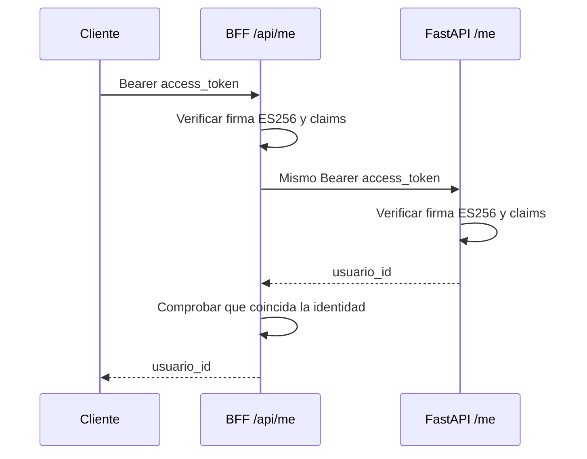

# Segundo incremento: identidad en el BFF

GET /api/me verifica el token original de Supabase y llama a GET /me de FastAPI
con ese mismo token. Ambos servicios verifican identidad de forma independiente.
El BFF devuelve solo usuario_id y comprueba que coincida con el sub verificado.
No crea otro token ni confia en X-User-Id. No crea perfiles ni espacios.

La prueba manual previa de FastAPI con un usuario real fue exitosa: Supabase
emitio la sesion, /me devolvio 200 con el mismo usuario y sin token devolvio 401.
La prueba real a traves del BFF queda pendiente de desplegar este incremento.

## Configuracion de test

Despues de integrar y desplegar el PR, agregar en gastos-test-bff:

    AUTH_SUPABASE_PROJECT_REF=cyxhyfbiacfayixbmotq

API_BASE_URL debe seguir apuntando a https://gastos-test-api.onrender.com, sin
ruta adicional. El nuevo endpoint solo permite HTTPS salvo hosts locales de
desarrollo. No necesita contraseñas de PostgreSQL, clave privada de firma ni
Publishable key. Save and deploy aplica la configuracion; Auto-Deploy sigue Off.

Se conserva API_TIMEOUT_MS, incluido el valor configurado para arranque en frio.
Sin configuracion Auth se devuelve 503 a una peticion Bearer; sin credencial,
401. Las rutas publicas del esqueleto no dependen de Auth.

## Contrato y errores

Se usa jose para validar firma ES256, issuer exacto, audiencia escalar
authenticated, exp, iat, nbf cuando exista y tolerancia de reloj de 30 segundos.
Se exigen role=authenticated, is_anonymous=false, sub y session_id UUID no nulos
en el formato con guiones que emite Supabase. Expiracion posterior a emision.
No se aceptan headers JWT con ubicaciones de claves, tokens mayores de 16 KiB
ni Authorization duplicado.

JWKS: URL construida desde el proyecto configurado, timeout 5 s, cache 5 min,
cooldown 30 s, respuesta limitada a 64 KiB y hasta 16 claves. Fallos de descarga
tienen un intervalo de reintento de 30 s. No hay redirecciones ni uso de claves
vencidas ante una caida. Reiniciar el servicio vacia su cache local; Supabase
tambien tiene cache externa. No se promete revocacion inmediata de sesiones.

401 indica credencial ausente o invalida e incluye WWW-Authenticate: Bearer.
503 indica verificador no disponible. 502 indica fallo de comunicacion o
respuesta invalida de FastAPI, incluida una identidad diferente. Las respuestas
incluyen Cache-Control: no-store. No se copian mensajes internos ni causas con
tokens a las respuestas o logs. No se reenvian headers arbitrarios del cliente.

## Pruebas y limites

    cd apps/bff
    npm ci
    npm test
    npm run test:e2e
    npm run build

Las pruebas usan claves efimeras y tokens firmados, con descargas JWKS y FastAPI
simulados. Cubren contrato de claims, firma, cache, rotacion, errores, reenvio
exacto del token, identidad diferente, redirecciones y HTTPS.

Pendiente: prueba real /api/me, pantallas Angular, registro y alta inicial del
espacio, persistencia de sesion y conexion del usuario autenticado al contexto
transaccional. Este incremento no completa US-001 ni US-002.

Referencia: https://github.com/panva/jose
