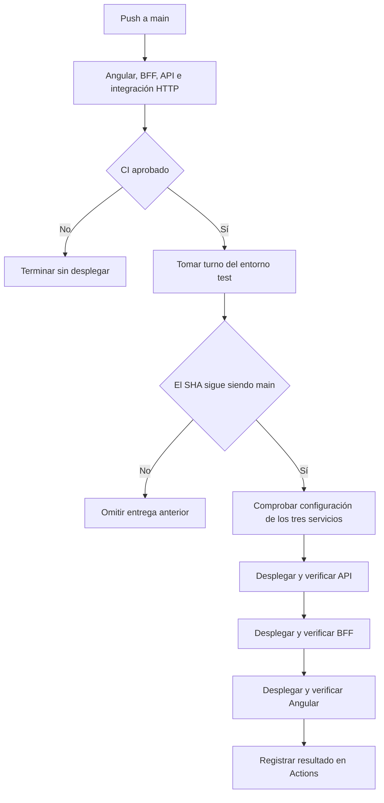

# Despliegue continuo del entorno de test

Documento preparado el 20 de octubre de 2026. La primera ejecución real de este flujo se verifica después de configurar el environment de GitHub e integrar el cambio; las pruebas locales usan respuestas simuladas y no publican servicios.

## Objetivo y alcance

El workflow de CI publica el mismo commit aprobado en los tres servicios existentes de Render. El entorno contiene el recorrido de prueba Angular → BFF → FastAPI. No administra datos financieros, Supabase ni autenticación todavía.

| Entorno | Uso en este incremento |
|---|---|
| `dev` | Desarrollo local en Ubuntu y Docker Compose. |
| `test` | Servicios gratuitos de Render; despliegue automático desde `main` después de CI. |
| `prod` | Pendiente de configuración y decisión de hosting. Se prevé aprobación manual; no se implementa aquí. |

## Flujo del workflow

El quinto trabajo de `.github/workflows/ci.yml` depende de `web`, `bff`, `api` e `integration` mediante `needs`. Solo se habilita para el evento `push` de `main`; un PR conserva las comprobaciones y omite el despliegue. [Dependencias y condiciones de los trabajos](https://docs.github.com/en/actions/reference/workflows-and-actions/workflow-syntax#jobsjob_idneeds).

En Actions aparece como **Publicar test en Render**; su identificador es `deploy_test`.



Se descarga el SHA que disparó la ejecución. `infra/cd/check_main.py` consulta la referencia actual de `main` con el token de lectura temporal que proporciona GitHub y decide si continúa. Si apareció una integración más reciente antes de esa comprobación, se omite el despliegue anterior. Si la rama avanza después de empezar, la entrega continúa con su SHA original; la siguiente ejecución podrá publicar la nueva versión. No es un bloqueo de la rama ni una operación atómica entre tres servicios.

El grupo de concurrencia `render-test`, con `cancel-in-progress: false`, permite un solo trabajo de despliegue a la vez. La cancelación automática del workflow se desactiva en `main` para no interrumpirlo desde un nivel superior. Las otras ramas conservan la cancelación de ejecuciones anteriores. Los trabajos pendientes pueden ser sustituidos por ejecuciones posteriores; no se garantiza publicar cada commit intermedio. [Concurrencia en GitHub Actions](https://docs.github.com/en/actions/how-tos/write-workflows/choose-when-workflows-run/control-workflow-concurrency).

## Configuración de GitHub y Render

Crear el environment de GitHub **`test`** antes de integrar este incremento. Permitir únicamente la rama `main` en **Selected branches and tags**, sin revisores obligatorios para este entorno automático.

| Clase | Nombre | Valor |
|---|---|---|
| Environment secret | `RENDER_API_KEY` | API key creada manualmente en Account Settings de Render. |
| Environment variable | `RENDER_API_SERVICE_ID` | `srv-dbb9h0jncjis7391fpe0` |
| Environment variable | `RENDER_BFF_SERVICE_ID` | `srv-dbbqgku1egvs73av7k60` |
| Environment variable | `RENDER_WEB_SERVICE_ID` | ID `srv-...` del sitio `gastos-test-web`, tomado de su panel. |

Los identificadores y las direcciones públicas pueden versionarse. La clave se guarda directamente en GitHub, sin incluirla en archivos, ejemplos con valores reales ni historial de terminal. El trabajo declara `environment: test` y recibe el secreto solo para su ejecución.

La API key de Render tiene acceso a todos los workspaces a los que pertenece el usuario, según sus permisos. El environment de GitHub limita su disponibilidad en el workflow; no reduce el alcance de la credencial en Render. Revocar y reemplazar la clave si se expone. [Autenticación de Render](https://api-docs.render.com/reference/authentication).

Los tres servicios deben conservar **Auto-Deploy: Off**. Los permisos de publicación quedan a cargo de la API y las decisiones de cuándo publicar, de GitHub. La configuración de ejecución y del build de Angular está en [Despliegue de test](despliegue-test.md).

## Programa y contrato de publicación

Los programas usan únicamente la biblioteca estándar de Python.

| Archivo | Función |
|---|---|
| `.github/workflows/ci.yml` | Orden, condiciones, environment y concurrencia de CI y CD. |
| `infra/cd/check_main.py` | Evita iniciar una entrega que ya quedó atrás respecto de `main`. |
| `infra/cd/render-test.json` | Repositorio, rama, tipos y direcciones esperadas. |
| `infra/cd/deploy_render.py` | Comprobación previa, publicación secuencial y verificación pública. |
| `infra/cd/test_*.py` | Pruebas con comunicaciones y esperas sustituidas. |

Antes de publicar comprueba los tres identificadores, que sean distintos y que Render informe el repositorio, la rama, el tipo y la URL esperados. También exige Auto-Deploy desactivado: usa `autoDeployTrigger` cuando existe y el campo anterior `autoDeploy` como respaldo.

| Orden | Servicio | URL pública | Tipo |
|---|---|---|---|
| 1 | API | `https://gastos-test-api.onrender.com` | `web_service` |
| 2 | BFF | `https://gastos-test-bff.onrender.com` | `web_service` |
| 3 | Angular | `https://gastos-test-web.onrender.com` | `static_site` |

Para cada servicio envía `POST /v1/services/{id}/deploys` con `commitId` igual al SHA validado. Conserva el ID devuelto y consulta `GET /v1/services/{id}/deploys/{deployId}` hasta obtener `live` y confirmar el commit. La API de Render no desactiva Auto-Deploy por incluir `commitId`; por eso se comprueba previamente. [Crear despliegue](https://api-docs.render.com/reference/create-deploy), [consultar despliegue](https://api-docs.render.com/reference/retrieve-deploy).

Las consultas GET pueden reintentarse ante errores temporales. Los POST no se reintentan automáticamente: un timeout no demuestra que Render haya rechazado la petición. Una respuesta 202 sin un ID utilizable detiene el flujo y requiere revisar el panel. El script no interpreta una aceptación como una publicación completada.

Después de cada despliegue se comprueba la respuesta pública:

| Componente | Comprobaciones |
|---|---|
| API | `/health` correcto y `/version` con el SHA solicitado. |
| BFF | Salud, versión y `/api/hello` con el mensaje esperado; CORS permite el origen exacto de Angular. |
| Angular | `/version.json` con el mismo SHA, HTML de la aplicación y un módulo JavaScript accesible. |

Las comprobaciones HTTP no ejecutan Angular en un navegador. La prueba del botón y la prueba desde un celular siguen siendo verificaciones de la experiencia de uso. Tampoco se considera comprobado el primer acceso después del reposo por haber pasado el despliegue.

Render reconstruye el código del commit indicado. Esta entrega garantiza la coincidencia del SHA comprobado, no la reutilización de un binario único generado en CI. Todavía no se promueven imágenes por digest entre entornos.

## Tiempos, resultados y recuperación

El programa usa un presupuesto de 900 segundos por despliegue y consulta su estado aproximadamente cada 15 segundos. Cada comprobación pública tiene un presupuesto de 180 segundos. Una solicitud HTTP ya iniciada puede sobrepasar el presupuesto; cada solicitud tiene un timeout de 30 segundos. El trabajo de GitHub tiene un límite total de 90 minutos para dar margen a la suma de comprobaciones y reintentos. Las esperas admiten las demoras de los servicios gratuitos, sin prometer que todo primer acceso finalizará correctamente.

El resumen de Actions registra el SHA y los IDs `dep-...`. El trabajo solo informa éxito después de comprobar los tres servicios. Para diagnosticar un fallo, relacionar ese ID con su despliegue en Render y comparar las versiones públicas.

Un fallo detiene la secuencia. Si una parte ya se publicó, puede quedar una mezcla temporal de versiones; no hay rollback automático ni una transacción que abarque los tres servicios. Ante un timeout de publicación, revisar primero el panel antes de reintentar para evitar solicitudes duplicadas.

No ejecutar despliegues manuales mientras esté activo el automático. Para una recuperación manual, elegir un SHA conocido mediante **Manual Deploy → Deploy a specific commit**, restaurar las versiones compatibles y volver a verificar el recorrido. Eso no revierte el repositorio: corregir o revertir `main` si se necesita conservar el estado recuperado en las siguientes entregas.

## Pruebas y evolución

Desde la raíz del repositorio:

```bash
python3 -m unittest discover -s infra/cd -p 'test_*.py'
```

Las pruebas sustituyen las comunicaciones HTTP y las esperas. No usan una clave, no llaman a Render ni publican aplicaciones. No ejecutar el programa de despliegue manualmente como parte de la comprobación local.

Por simplicidad, cada integración despliega los tres servicios. Ese comportamiento consume builds incluso cuando un componente no cambió; se podrá optimizar por archivos afectados si el uso lo justifica. Los servicios gratuitos conservan sus límites y su reposo; no se programan pings para mantenerlos activos.

Al incorporar la base de datos habrá que ampliar el flujo a **CI → provisión cuando corresponda → migraciones → despliegue → verificación**, con las credenciales y las reglas de los ADR. Este programa no ejecuta migraciones ni cubre ese escenario todavía. La publicación de producción requiere un incremento separado.
