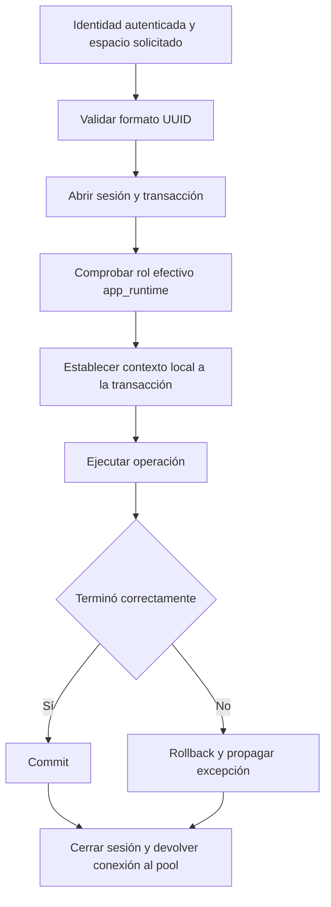

# US-007, paso 2: contexto transaccional

> Guía de un paso anterior. Para el estado consolidado del PR y sus pendientes, consultar [Estado de US-007](estado-us-007.md).

Una operación de la aplicación usa una sesión de SQLAlchemy y una transacción.
La conexión física se toma del pool y puede ser reutilizada por otra operación.
La sesión no se comparte entre usuarios ni entre tareas concurrentes.

runtime_transaction recibe un engine runtime, un usuario UUID obligatorio y un
espacio UUID opcional. La identidad debe provenir de autenticación ya validada;
esta función no verifica tokens ni acepta como confiable un usuario enviado por el cliente.

## Recorrido



El contexto se establece con parámetros vinculados mediante set_config y su
tercer argumento true. No se concatena el UUID dentro del SQL. app.user_id
identifica al usuario y app.workspace_id al espacio solicitado. Si no hay espacio,
se establece una cadena vacía explícita; no se conserva la selección anterior.
Esto permitirá listar espacios o leer un perfil antes de seleccionar un espacio.

Las policies comprobarán membresía y permisos más adelante. Un UUID válido no
prueba identidad, pertenencia ni autorización. No se concede acceso a tablas en
este incremento; tampoco se expone un endpoint para elegir libremente usuario.

## Uso dentro de la aplicación

```python
from app.db.unit_of_work import runtime_transaction

# usuario_id debe provenir de la autenticación, no de un campo del cliente.
with runtime_transaction(engine_runtime, usuario_id=usuario_id,
                         espacio_id=espacio_id) as session:
    # Repositorios y materialización de resultados van dentro del bloque.
    # No hacer commit, rollback o begin manualmente aquí.
    pass
```

Una salida normal confirma los cambios; una excepción provoca rollback y sigue
propagándose. Session.begin y Session.close gestionan también la salida por
BaseException. La sesión queda cerrada de forma definitiva al salir. autobegin
está desactivado para evitar transacciones implícitas adicionales. Los repositorios
no controlan el commit: esta es una convención de uso, no una barrera frente a
código malicioso con acceso a la sesión o a las credenciales.

No retornar consultas diferidas ni objetos que necesiten cargar atributos después
del cierre: construir la respuesta dentro del bloque. La implementación es síncrona;
cuando se integre con FastAPI, deberá respetar su modelo de ejecución y probar las
cancelaciones reales de requests. Una cancelación simulada no prueba ese recorrido HTTP.

No usar SET de sesión ni set_config con false para estos parámetros. El alcance
local restaura el valor previo al finalizar: no sanea por sí solo una conexión
contaminada por código que haya persistido identidad a nivel sesión.

## Qué verifica CI

La fase 7 de check_database.py usa un engine runtime nuevo y operaciones
secuenciales. Compara pg_backend_pid para exigir la reutilización de la misma
conexión física, en lugar de pasar la prueba por abrir otra conexión vacía.

- Contexto A dentro de su transacción y ausencia de contexto fuera de ella.
- Contexto B al reutilizar la conexión de A.
- Operación con usuario pero sin espacio seleccionado.
- Limpieza tras una excepción de aplicación, CancelledError simulado y un error SQL real.
- Una operación posterior funciona con la identidad correcta.
- Rechazo de un engine conectado como migrator antes de entregar la sesión al llamador.
- Imposibilidad de reutilizar la sesión cerrada.

Las pruebas unitarias rechazan valores inválidos antes de abrir sesión y evitan
repetir valores de entrada en mensajes de error. Los tests reales no imprimen
contraseñas ni URLs de conexión y usan la base desechable del pipeline.

No hay migración nueva: el esquema sigue en 0002. Quedan pendientes perfiles,
policies de datos, aislamiento entre filas, integridad entre espacios y pruebas
completas de seguridad para cerrar US-007.

## Referencias

- [Sesiones y transacciones, SQLAlchemy 2.0](https://docs.sqlalchemy.org/en/20/orm/session_basics.html).
- [set_config, PostgreSQL 17](https://www.postgresql.org/docs/17/functions-admin.html#FUNCTIONS-ADMIN-SET).
