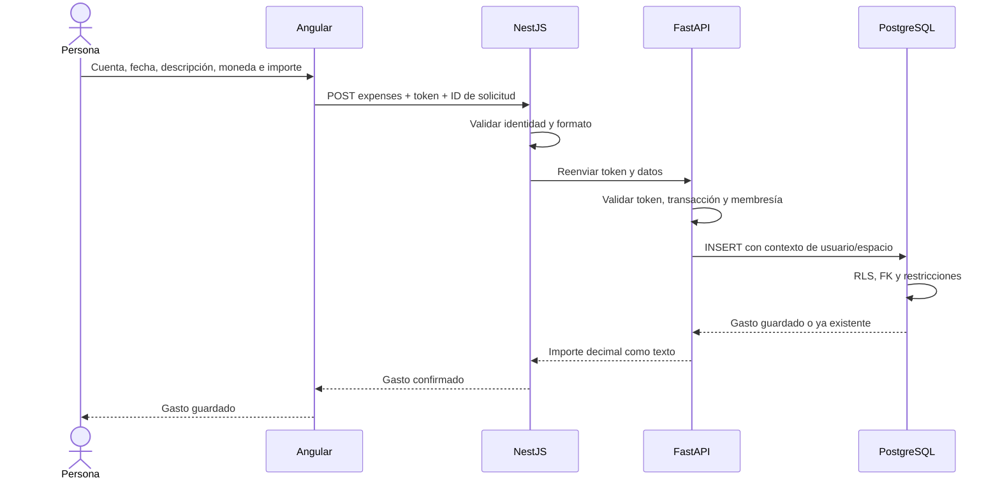

# Registrar gastos por cuenta

Una misma cuenta puede contener gastos en ARS, USD y EUR. La moneda pertenece a cada gasto. No hay conversiones ni un total que mezcle monedas.

## Recorrido

1. Iniciar sesión y abrir el espacio personal.
2. Elegir «Ver gastos» en una cuenta.
3. Completar fecha, descripción, moneda e importe; pulsar «Registrar gasto».
4. El gasto aparece en la lista. Al recargar se recupera desde PostgreSQL.

Angular envía el token al BFF, que lo valida y lo reenvía a FastAPI. FastAPI vuelve a validarlo, establece usuario y espacio en la transacción y comprueba membresía y cuenta. PostgreSQL aplica RLS y una FK compuesta impide relacionar gastos con cuentas de otro espacio.

## Contrato

- `GET/POST /spaces/{space}/accounts/{account}/expenses` en API, con prefijo `/api` en BFF.
- POST recibe `id`, `fecha` ISO, `descripcion` (1–160 caracteres), `moneda` e `importe` como cadena decimal positiva.
- La pantalla acepta coma o punto decimal, sin separadores de miles. Rechaza más de dos decimales. Máximo: 999999999999.99.
- El importe viaja como texto y se almacena como `NUMERIC(14,2)`. No pasa por floats. La validación HTTP rechaza decimales sobrantes antes de que PostgreSQL pueda redondearlos.
- El creador se obtiene del JWT. El cliente no puede enviar una identidad distinta.
- Owner y editor registran; lector consulta. Runtime no puede modificar ni borrar gastos en esta versión.
- Lista por fecha descendente e ID descendente, páginas de 100. Si hay altas concurrentes, actualizar la lista antes de recorrerla completa; la paginación por offset no es una instantánea.
- Un reintento con el mismo ID y contenido devuelve el gasto existente. El mismo ID con contenido diferente devuelve 409. El formulario conserva ese ID mientras se reintenta sin cambiar los datos.
- Tras recargar o cambiar de cuenta se pierde el ID pendiente del formulario: si hubo un error de comunicación, revisar la lista antes de volver a cargar el gasto.

## Validación

CI reconstruye una base desechable y prueba monedas diferentes en la misma cuenta, precisión decimal, reintentos concurrentes, permisos, revocación, FK entre espacios y paginación. Las pruebas de Angular y BFF cubren el contrato y el reintento.

Prueba manual en test: registrar ARS 1250,50 y USD 10,00 en la misma cuenta, actualizar la página y verificar que aparecen separados con sus monedas. También probar un importe con tres decimales y confirmar que no se guarda.

La migración 0008 se aplica por el pipeline antes de desplegar. No requiere nuevas variables de Render. Esta entrega no incluye ingresos, saldo, categorías, edición ni eliminación.
